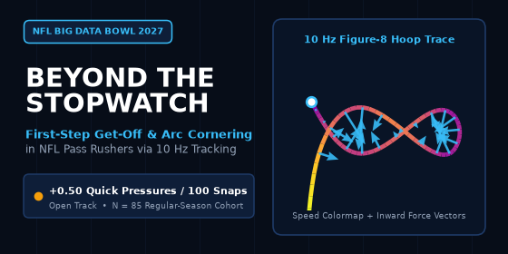
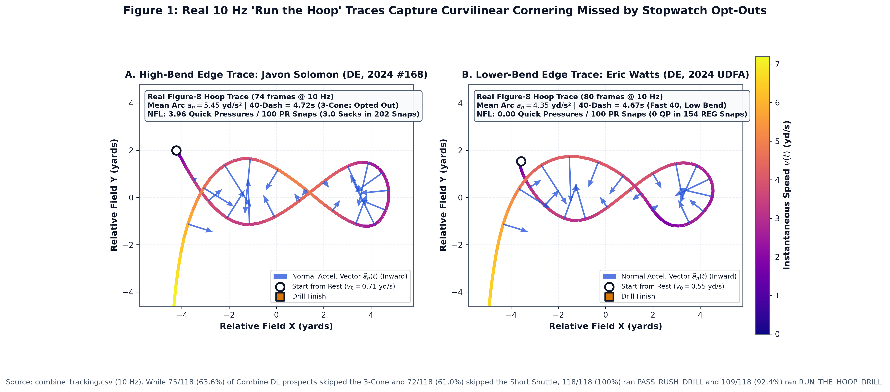
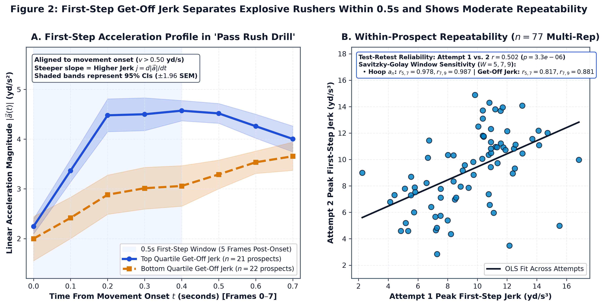
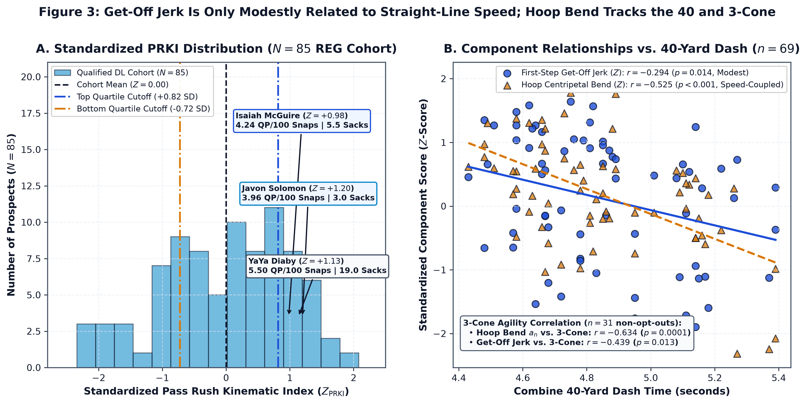
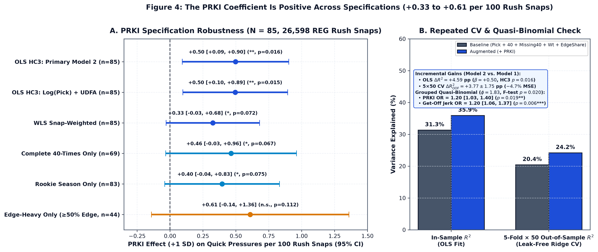
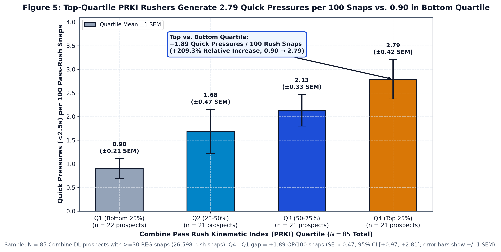
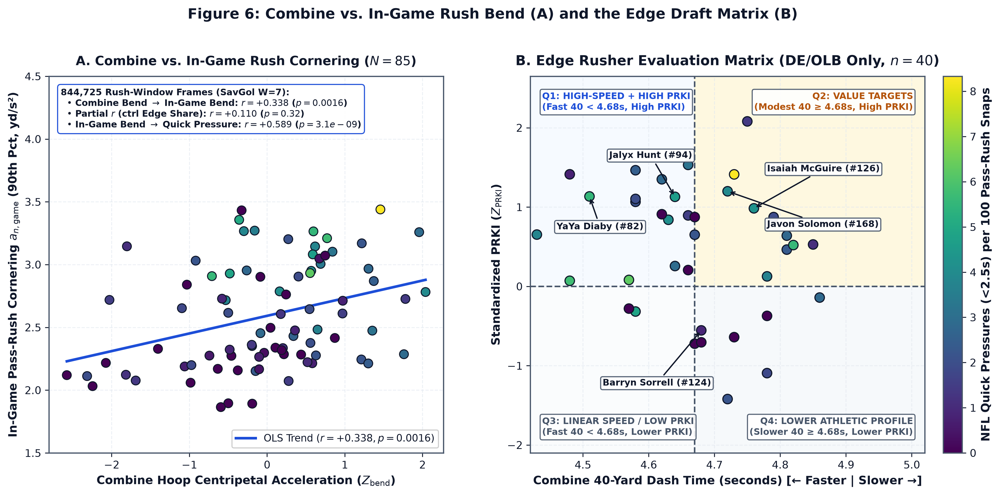

<div align="center">



# Beyond the Stopwatch
### Quantifying First-Step Get-Off and Arc Cornering in NFL Pass Rushers via 10 Hz Tracking

[](writeup/final_writeup.md)
[](requirements.txt)
[](LICENSE)

📄 **[Read the Final Writeup (Markdown)](writeup/final_writeup.md)** &nbsp;•&nbsp; 📕 **[Download 7-Page Publication PDF](writeup/nfl_big_data_bowl_2027_final_submission.pdf)** &nbsp;•&nbsp; 📓 **[Open Kaggle Submission Notebook](notebooks/nfl_big_data_bowl_2027_submission.ipynb)**

</div>

---

## 1. The Football Problem: The Combine Agility Blind Spot

NFL pass rushers win by exploding off the ball and turning a tight arc around the offensive tackle, yet pre-draft evaluation still leans heavily on straight-line 40-yard dash times while prospects increasingly skip traditional change-of-direction drills:
- **63.6% of Combine defensive linemen** (75 of 118; 42 of 66 edge rushers) **opted out of the 3-Cone Drill** across 2023–2025, and **61.0%** skipped the Short Shuttle.
- By contrast, **100.0% (118 of 118)** participated in `PASS_RUSH_DRILL` and **92.4% (109 of 118)** completed `RUN_THE_HOOP_DRILL` with full 10 Hz optical sensor tracking.

From these universally run positional drills, we construct the **Pass Rush Kinematic Index (PRKI)** — an equally weighted, standardized composite of:
1. **First-Step Get-Off Jerk (`j_get-off`):** Peak rate of acceleration buildup (`d|a(t)|/dt`) over the first 0.50 seconds (5 frames) following movement onset (`v > 0.50 yd/s`) in `PASS_RUSH_DRILL`.
2. **Hoop Centripetal Acceleration (`a_n,hoop = v²κ`):** Mean inward normal acceleration along the curved figure-eight path (`v > 1.50 yd/s`, `κ > 0.15 yd⁻¹`) in `RUN_THE_HOOP_DRILL`.

---

## 2. Headline Empirical Findings (`N = 85` Regular-Season Cohort)

Across **85 qualified defensive linemen** (`≥ 30` regular-season defensive snaps; **26,598 regular-season pass-rush snaps** and **844,725 rush-window tracking frames** across 2023–2025):

| Benchmark / Specification | Empirical Estimate | Key Takeaway |
| :--- | :--- | :--- |
| **Primary OLS (HC3 Robust SEs)** | **+0.50 QP / 100 rush snaps** (`95% CI [+0.09, +0.90]`, `p = 0.016`) | **+18.8% lift** over pooled cohort rate (2.65 QP/100) beyond draft pick, 40-time, weight & edge alignment (`ΔR² = +4.59 pp`) |
| **Grouped Quasi-Binomial GLM (`φ = 1.83`)** | **OR = 1.200** (`95% CI [1.030, 1.397]`, `p = 0.019`) | Accounts for unequal snap volume & overdispersion (`F(1, 78) = 5.66`, `p = 0.020` vs. baseline) |
| **Component Decomposition (Model 2b)** | Get-Off Jerk: **+0.38** (`p = 0.049`, QB `OR = 1.202`, `p = 0.006`)<br>Hoop Bend: **+0.19** (`p = 0.348`, QB `OR = 1.030`, `p = 0.666`) | **First-step explosion carries the NFL pass-rush signal**; hoop bend serves primarily as a 3-cone stand-in (`r = −0.634`) for opt-outs |
| **5×50 Repeated Ridge Cross-Validation** | **+3.77 ± 1.75 pp held-out R²** (`20.4% → 24.2%`, `−4.7% MSE`) | Leak-free in-fold standardization confirms out-of-sample predictive lift |
| **Top vs. Bottom PRKI Quartiles** | **2.79 vs. 0.90 QP / 100 snaps** (`+1.89` gap, `95% CI [+0.97, +2.81]`) | Translates to **~7.6 additional quick pressures** over a 400-snap season |
| **Combine-to-Game Tracking Audit** | Hoop → Game Bend: raw `r = +0.34`, partial `r = +0.11` (`p = 0.32`)<br>Jerk → NFL `player_get_off`: `β = −0.007s` (`p = 0.48`) | Direct movement translation attenuates after controlling for alignment; first-step burst aids rush wins without shortening snap-to-line crossing time |

---

## 3. Publication Figure Suite (300 DPI, Colorblind-Safe)

| Figure | Preview & Summary |
| :--- | :--- |
| **Figure 1**<br>*Agility Opt-Out Blind Spot* | <br>Real 10 Hz `RUN_THE_HOOP_DRILL` trajectories (Javon Solomon vs. Eric Watts) & 63.6% 3-Cone opt-out rates. |
| **Figure 2**<br>*First-Step Jerk & Repeatability* | <br>Onset-aligned acceleration curves (Top Quartile `n = 21` vs. Bottom Quartile `n = 22`) and multi-rep reliability (`r = 0.502`). |
| **Figure 3**<br>*PRKI Distribution & Stopwatch Links* | <br>Standardized cohort distribution (`N = 85`) and correlations against electronic 40-yard dash (`n = 69`) and 3-cone (`n = 31`). |
| **Figure 4**<br>*Econometric Forest & CV* | <br>PRKI effect stability across 6 model specifications (`+0.33` to `+0.61` QP/100) and 5×50 out-of-sample cross-validation. |
| **Figure 5**<br>*NFL In-Game Production* | <br>Monotonic progression of regular-season quick pressures (<2.5s) per 100 pass-rush snaps across PRKI quartiles. |
| **Figure 6**<br>*In-Game Bend & Draft Matrix* | <br>844,725-frame Combine-to-NFL cornering validation and Day 3 Edge Rusher Evaluation Matrix (`DE`/`OLB`, `n = 40`). |

---

## 4. Repository Structure

```text
NFL_Big_Data-Bowl_2027/
├── README.md                          # Project overview, key findings & reproduction guide
├── LICENSE                            # MIT open-source license
├── requirements.txt                   # Python package dependencies
├── data/
│   └── README.md                      # Instructions for placing official Kaggle competition CSVs
├── processed/
│   └── model_results.json             # Authoritative serialized cohort, regression & CV results
├── src/
│   ├── run_pipeline.py                # Unified CLI runner (fast reproduction or full --from-raw)
│   ├── etl.py                         # Raw CSV -> Snappy Parquet ingestion & schema validation
│   ├── kinematics.py                  # 10 Hz Savitzky-Golay smoothing, curvature & jerk engine
│   ├── models.py                      # OLS HC3, WLS, Quasi-Binomial GLM, MixedLM & 5x50 CV
│   ├── plots.py                       # 6-figure 300 DPI colorblind-safe visualization suite
│   ├── build_notebook.py              # Compiles self-contained Kaggle submission notebook
│   ├── md_to_pdf.py                   # Compiles final writeup into 7-page publication PDF
│   └── generate_thumbnail.py          # Generates 560x280 project thumbnail
├── notebooks/
│   └── nfl_big_data_bowl_2027_submission.ipynb  # Self-contained public Kaggle notebook
├── figures/                           # 6 publication figures (300 DPI) + 560x280 thumbnail
└── writeup/
    ├── final_writeup.md               # Master competition writeup (<= 2,000 words, 8 visuals)
    └── nfl_big_data_bowl_2027_final_submission.pdf  # Compiled 7-page executive PDF
```

---

## 5. Quickstart & Reproducibility

### Setup Environment

```bash
git clone https://github.com/sakthimalai/NFL_Big_Data-Bowl_2027.git
cd NFL_Big_Data-Bowl_2027

python -m venv .venv
# Windows PowerShell:
.\.venv\Scripts\Activate.ps1
# macOS / Linux:
# source .venv/bin/activate

pip install -r requirements.txt
```

### Option A: Fast Verification & Notebook Build (No 2.3 GB Raw Data Download Needed)

Using the serialized `processed/model_results.json` and pre-rendered figures included in this repository, you can verify all statistical benchmarks and rebuild or execute the submission notebook immediately:

```bash
python src/run_pipeline.py
jupyter notebook notebooks/nfl_big_data_bowl_2027_submission.ipynb
```

### Option B: Full End-to-End Pipeline from Raw Kaggle CSVs

1. Download the 9 competition CSV files from Kaggle and place them in `data/` (see [`data/README.md`](data/README.md)).
2. Execute the complete ingestion, kinematic signal processing, econometric estimation, figure generation, and PDF compilation pipeline:

```bash
python src/run_pipeline.py --from-raw --pdf
```

---

## 6. Acknowledgments

Data provided by the **National Football League (NFL)**, **Next Gen Stats**, and **Kaggle** for the **NFL Big Data Bowl 2027** (*Combine to NFL Performance*).
