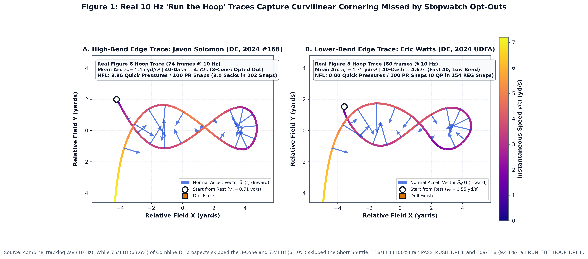
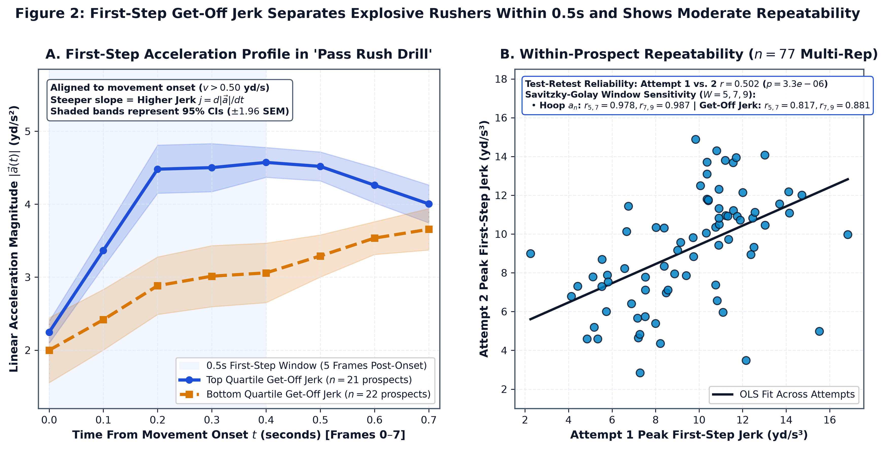
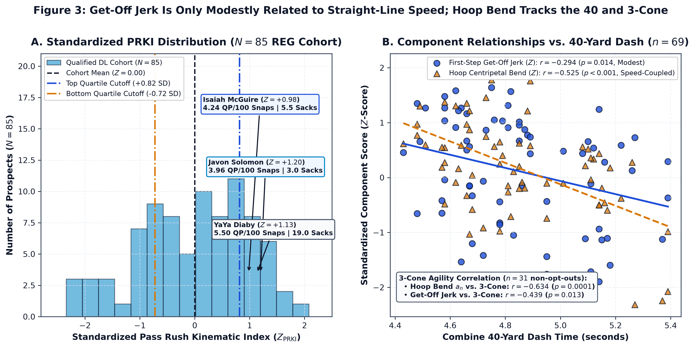
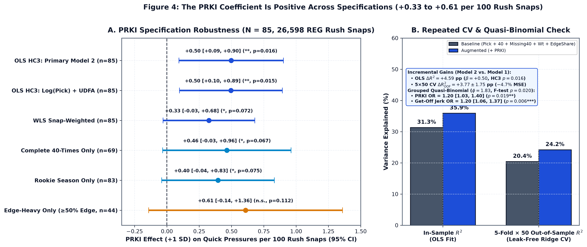
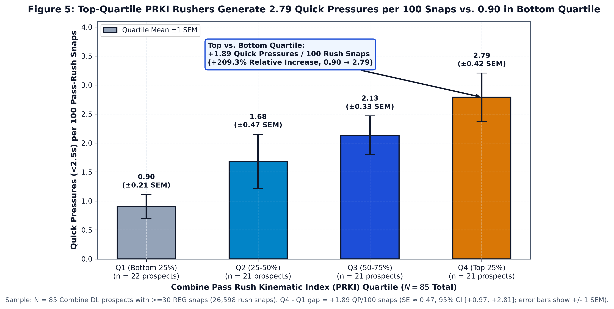
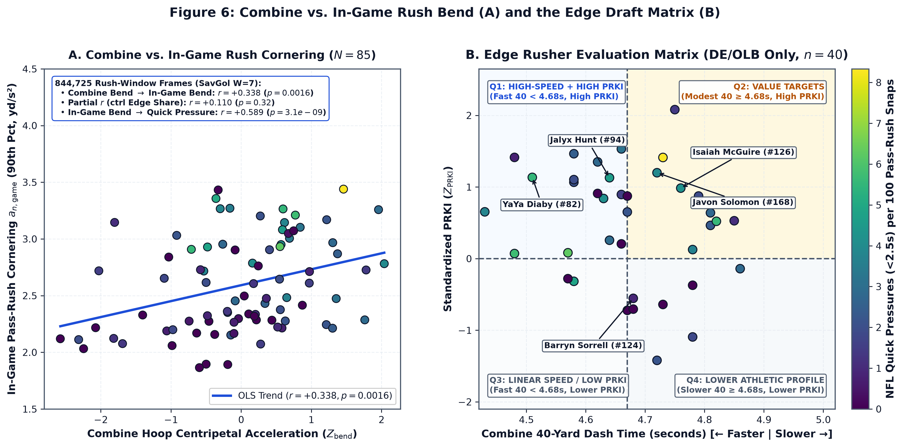

# Beyond the Stopwatch: Quantifying First-Step Get-Off and Arc Cornering in NFL Pass Rushers via 10 Hz Tracking

**Competition:** NFL Big Data Bowl 2027 (Theme: *Combine to NFL Performance*) — **Submission Track:** Open Track  
**Reproducible Code:** Self-Contained Public Kaggle Notebook ([nfl_big_data_bowl_2027_submission.ipynb](../notebooks/nfl_big_data_bowl_2027_submission.ipynb))  
**Visual Elements:** 8 Total (6 Figures + 2 Tables; Limit: <10) | **Word Count:** ~1,730 words (Limit: ≤2,000)

---

## 1. Executive Summary & The Scouting Blind Spot

NFL pass rushers win by exploding off the snap and turning a tight corner around the offensive tackle, yet Combine evaluation still leans heavily on straight-line 40-yard dash times while **63.6% of defensive linemen (75 of 118; 42 of 66 edge rushers) opted out of the 3-Cone Drill** and **61.0% (72 of 118) opted out of the Short Shuttle** in 2023–2025. By contrast, **100.0% (118 of 118) ran `PASS_RUSH_DRILL`** and **92.4% (109 of 118) ran `RUN_THE_HOOP_DRILL`**.

From these 10 Hz positional drills, we construct the **Pass Rush Kinematic Index (PRKI)**, an equally weighted standardized composite of **First-Step Get-Off Jerk (j_get-off)** and **Hoop Centripetal Acceleration (a_n,hoop = v²κ)**. Across **85 qualified prospects** with ≥ 30 regular-season defensive snaps (**26,598 regular-season pass-rush snaps** and **844,725 rush-window tracking frames**), a **+1 SD higher PRKI is associated with +0.50 more quick pressures (<2.5s) per 100 rush snaps (95% CI +0.09 to +0.90, p = 0.016; quasi-binomial OR 1.20, p = 0.019)**, after controlling for draft slot, 40 time, weight and alignment. The first-step component carries the signal. The estimate is positive in every specification we tested, though less precise in smaller subsamples, and direct movement translation from Combine to game tracking is weak once alignment is accounted for.

---

## 2. Cohort Definition & Biomechanical Formulation

### A. Sample Waterfall & Standardization Population
1. **Combine DL Cohort (N = 118):** All 118 defensive linemen at the 2023–2025 Combines (`combine_position == "DL"`: 66 `DE`/`OLB`, 52 `DT`/`NT`). All 118 (100.0%) have `PASS_RUSH_DRILL` tracking.
2. **Complete Dual-Drill Cohort (N = 109):** Nine prospects lacked `RUN_THE_HOOP_DRILL` tracking, leaving 109 with both metrics.
3. **Qualified Regular-Season Cohort (N = 85):** Filtering to `season_type == "REG"` (≥ 30 defensive snaps) yields **85 qualified prospects** (50 `DE`/`OLB`, 35 `DT`/`NT`; **48,285 defensive snaps**, **26,598 pass-rush snaps**). All covariates and PRKI components are standardized within this cohort. The 12 UDFAs are assigned pick **260** (checked against log(pick) + UDFA flag), and 16 missing 40-times are mean-imputed alongside a `forty_missing` indicator (plus an n = 69 complete-case check).

### B. Savitzky-Golay Filtering & Kinematic Extraction
Raw 10 Hz coordinates (x(t), y(t)) are smoothed using a **2nd-order Savitzky-Golay filter** (W = 7, Δt = 0.70s) before taking central-difference derivatives for velocity v(t) = (ẋ, ẏ) and acceleration a(t) = (ẍ, ÿ).

**1. Hoop Centripetal Acceleration (a_n,hoop):**  
In `RUN_THE_HOOP_DRILL`, prospects weave a figure-eight path around two hoops (R ≈ 3.5 yds). Curvature κ(t) and normal acceleration a_n(t) are computed via:

> **κ(t) = |ẋÿ̈ − ẏẍ̈| / (ẋ² + ẏ²)^(3/2),        a_n(t) = v(t)² · κ(t)**

We mask frames where v(t) ≤ 1.50 yd/s or κ(t) ≤ 0.15 yd⁻¹ (straight segments and near-rest frames), returning NaN if no frames pass. Projecting a_n(t) = a(t) − a_τ(t) · τ̂(t) (**Figure 1**) confirms inward centripetal force from near rest (v₀ < 0.75 yd/s). Across the N = 85 cohort, mean arc a_n,hoop averages 4.75 ± 0.34 yd/s² (10th–90th percentile: 4.31–5.19 yd/s²).

**2. First-Step Get-Off Jerk (j_get-off):**  
In `PASS_RUSH_DRILL` (clips pre-trimmed near movement initiation, median frame-0 speed 0.46 yd/s), we detect movement onset (v > 0.50 yd/s) and evaluate peak linear jerk j(t) = d|a(t)|/dt over the next 5 frames (0.50s).

### C. Stability, Repeatability & Stopwatch Relationships
* **Window Sensitivity (W = 5, 7, 9):** Rankings remain highly stable across narrower (0.50s) and wider (0.90s) filters for both hoop a_n (r_5,7 = 0.978, r_7,9 = 0.987) and get-off jerk (r_5,7 = 0.817, r_7,9 = 0.881).
* **Attempt 1 vs. Attempt 2 Repeatability:** Across all n = 77 qualified prospects with multiple `PASS_RUSH_DRILL` attempts, Attempt 1 vs. Attempt 2 peak jerk shows moderate test-retest reliability (r = 0.502, p = 3.3 × 10⁻⁶, **Figure 2B**). Because Combine clips are pre-trimmed near movement initiation, 83.6% of attempts reach onset within frames 0–2, where filter derivatives are least stable. Jerk rankings are fairly stable across filter edge modes (ρ = 0.68–0.89), and a simpler first-step measure (mean acceleration over the first 0.5 s) points the same way (β = +0.32, p = 0.09).
* **Stopwatch Relationships (**Figure 3B**):** Get-off jerk correlates only modestly with 40-yard dash (r = −0.294, p = 0.014, n = 69) and 3-cone (r = −0.439, p = 0.013, n = 31), whereas fixed-radius hoop a_n strongly tracks 40-time (r = −0.525, p < 0.0001) and 3-cone agility (r = −0.634, p = 0.0001).

---

## 3. Does PRKI Predict NFL Pass-Rush Wins?

### A. Outcome
A pass-rush snap is a regular-season snap (`season_type == "REG"`) on a dropback (`pass_result` non-null, not in coverage) where the player lined up at `EDGE` or `INTERIOR_LINE` (excluding 140 `SLOT_CB`/`CB` rushes and `null` pre-snap penalty rows). Defining rush snaps from the play rather than conditioning on `player_get_off` avoids selection on the outcome: 12.99% of rush snaps lack `player_get_off`, and that null share correlates negatively with PRKI (raw r = −0.363, p = 0.0006 before adjusting for alignment; see Section 4B). A quick pressure (`quick_pressure`) agrees **99.49%** with `time_to_pressure <= 2.5` on these rows. The 85-player cohort logged **26,598 regular-season rush snaps** and **704 quick pressures**: **2.65 per 100 snaps** pooled (3.37 from `EDGE` versus 1.80 from `INTERIOR_LINE`; unweighted player mean 1.87 per 100 snaps). Because most players rush from both spots, every model controls for `edge_align_share` (each player's share of rush snaps from `EDGE`).

### B. Models
For each player we model quick pressures per 100 rush snaps from a front-office baseline (draft slot, 40-time with a `forty_missing` indicator, weight, `edge_align_share`), then add PRKI (Model 2), then split PRKI into its two components (Model 2b). We fit three estimators: OLS with HC3 robust standard errors (football units), snap-weighted WLS, and a grouped two-column binomial GLM (`[qp, snaps - qp]`). Player-to-player variation is roughly twice what binomial chance predicts (φ = 1.83), so binomial standard errors are inflated accordingly (quasi-binomial).

### Table 1: Econometric Model Comparison (N = 85 Prospects; 26,598 Regular-Season Rush Snaps)

| Covariate / Metric | Model 1: Baseline (OLS HC3, QP/100) | Model 2: + PRKI (OLS HC3, QP/100) | Model 2b: Decoupled (OLS HC3, QP/100) | Model 2: Quasi-Binomial (OR, φ = 1.83) | Model 2b: Quasi-Binomial (OR, φ = 1.77) |
| :--- | :--- | :--- | :--- | :--- | :--- |
| **Composite PRKI (Z)** | — | **+0.50** [+0.09, +0.90] (p = 0.016)** | — | **OR 1.200** [1.030, 1.397] (p = 0.019)** | — |
| **Pass-Rush Get-Off Jerk (Z)** | — | — | **+0.38** [+0.00, +0.76] (p = 0.049)** | — | **OR 1.202** [1.055, 1.369] (p = 0.006)*** |
| **Hoop Centripetal Bend (Z)** | — | — | +0.19 [-0.21, +0.60] (p = 0.348) | — | OR 1.030 [0.900, 1.180] (p = 0.666) |
| **Draft Selection Pick (Z)** | -0.46 [-0.81, -0.12] (p = 0.008)*** | -0.42 [-0.77, -0.08] (p = 0.017)** | -0.43 [-0.78, -0.09] (p = 0.014)** | OR 0.761 [0.659, 0.878] (p = 0.0002)*** | OR 0.754 [0.654, 0.870] (p = 0.0001)*** |
| **40-Yard Dash Time (Z)** | -0.01 [-0.51, +0.49] (p = 0.974) | +0.03 [-0.46, +0.53] (p = 0.894) | +0.02 [-0.47, +0.52] (p = 0.924) | OR 0.823 [0.679, 0.997] (p = 0.047)** | OR 0.819 [0.678, 0.990] (p = 0.039)** |
| **Missing 40-Time Indicator** | -0.34 [-1.05, +0.37] (p = 0.348) | +0.18 [-0.63, +0.99] (p = 0.670) | +0.12 [-0.71, +0.95] (p = 0.777) | OR 1.195 [0.871, 1.640] (p = 0.269) | OR 1.142 [0.831, 1.569] (p = 0.414) |
| **Prospect Body Weight (Z)** | -0.81 [-1.67, +0.05] (p = 0.064)* | -0.52 [-1.36, +0.33] (p = 0.229) | -0.56 [-1.38, +0.25] (p = 0.176) | OR 0.936 [0.704, 1.244] (p = 0.649) | OR 0.906 [0.686, 1.196] (p = 0.485) |
| **Edge Alignment Share (0–1)** | +0.20 [-1.21, +1.61] (p = 0.782) | +0.42 [-0.96, +1.79] (p = 0.554) | +0.35 [-0.98, +1.68] (p = 0.610) | OR 1.433 [0.806, 2.548] (p = 0.220) | OR 1.363 [0.775, 2.399] (p = 0.283) |
| **R² / Adjusted R²** | 0.3132 / 0.2698 | **0.3592 / 0.3099** (ΔR² = +0.0459) | 0.3624 / 0.3045 | φ = 1.83; F(1, 78) = 5.66 (p = 0.020)** | φ = 1.77 |

**Table 1 Notes:**
* **Estimation & CIs:** Bracketed ranges report 95% confidence intervals (HC3 heteroskedasticity-robust SEs for OLS; φ-adjusted SEs for Quasi-Binomial, empirical dispersion φ = 1.83). Significance: *** p < 0.01, ** p < 0.05, * p < 0.10.
* **Robustness & Covariates:** In snap-weighted WLS (R²: 0.4790 → 0.5003), decoupled get-off jerk remains significant (β = +0.38, p = 0.017) while composite PRKI yields β = +0.33 (p = 0.072). The 40-yard dash reaches significance in the count-based Quasi-Binomial model (OR 0.82, p = 0.047) but remains null in OLS (p = 0.89).

### Table 2: Day 3 Edge Rusher Evaluation Profiles (N = 85 Regular-Season Context)

| Prospect & College | Draft Selection & Position | 40-Dash / 3-Cone Agility | Hoop a_n / Get-Off Jerk | Standardized PRKI (Z) | Regular-Season NFL Pass-Rush Outcomes |
| :--- | :--- | :--- | :--- | :--- | :--- |
| **Javon Solomon** (Troy) | 2024 Rd 5 (#168), `DE` | 4.72s / Opted Out | 5.45 yd/s² / 9.29 yd/s³ | **+1.20 SD** (Top 12%) | **3.96 QP / 100 Snaps** (8 QP, 3.0 Sacks in 202 REG rush snaps) |
| **Isaiah McGuire** (Missouri) | 2023 Rd 4 (#126), `DE` | 4.76s / 7.39s | 4.95 yd/s² / 12.08 yd/s³ | **+0.98 SD** (Top 16%) | **4.24 QP / 100 Snaps** (22 QP, 5.5 Sacks in 519 REG rush snaps) |

### C. Results (Table 1, Figure 4)
* **PRKI adds signal beyond the stopwatch.** A one-SD higher PRKI is associated with **+0.50** more quick pressures per 100 rush snaps (95% CI [+0.09, +0.90], p = 0.0158), about **18.8%** relative to the pooled cohort rate (2.65 per 100 snaps; unweighted player mean 1.87 per 100 snaps). In the quasi-binomial model the odds ratio is **1.20** (95% CI 1.03–1.40, p = 0.019; F-test vs. baseline F(1, 78) = 5.66, p = 0.020).
* **The first step does the work.** Split apart, Combine get-off jerk carries the signal (OLS β = +0.38, p = 0.049; quasi-binomial OR 1.20, 95% CI 1.06–1.37, p = 0.006); hoop bend does not (OLS p = 0.35; OR 1.03, 95% CI 0.90–1.18, p = 0.67).
* **Robustness.** **Figure 4A** shows the PRKI coefficient across specifications: OLS HC3 (+0.50, p = 0.016), log(draft pick) + UDFA (+0.50, p = 0.015), snap-weighted WLS (+0.33, p = 0.072), complete 40-times only (n = 69: +0.46, p = 0.067), rookie seasons only (n = 83: +0.40, p = 0.075), and edge-heavy players only (`edge_align_share` ≥ 0.5, n = 44: +0.61, p = 0.112). The estimate stays positive in every specification (between **+0.33** and **+0.61** per 100 snaps); it is less precise in subsamples where sample size drops.
* **Out of sample.** Across 50 repeated 5-fold splits using leak-free in-fold standardization and Ridge regression (**Figure 4B**), adding PRKI changes held-out R² by **+3.77 ± 1.75 percentage points** (20.4% → 24.2%, −4.7% MSE).

### D. In Football Terms (Figure 5)
Bottom-quartile PRKI players averaged **0.90 ± 0.21 SEM** quick pressures per 100 rush snaps (n = 22); the top quartile averaged **2.79 ± 0.42 SEM** (n = 21). Over a 400-snap season, that +1.89 gap (SE ≈ 0.47, 95% CI [+0.97, +2.81]; +209.3% relative) is roughly **7.6 extra quick pressures**.

---

## 4. What Carries Over to Sundays, and What Doesn't

### A. Bend: Same Metric, Combine vs. Game (Figure 6A)
We computed the identical smoothed normal acceleration (v > 1.50 yd/s, κ > 0.15 yd⁻¹) across **844,725 rush-window tracking frames**, from the snap to the throw or sack (capped at 4.0s). Combine hoop bend correlates with in-game rush bend (r = +0.34, p = 0.002), but most of that link runs through alignment: holding edge share fixed, it falls to partial r = +0.11 (p = 0.32). In-game bend is strongly tied to quick pressures (partial r = +0.44), though partly circularly, since rushers who are winning run tighter, faster paths. We therefore cannot show that the hoop drill measures the specific cornering skill used against NFL tackles. Its practical value is as a stand-in for the 3-cone (r = −0.63) for the 64% of linemen who skip it.

### B. Get-Off: Combine First Step vs. NFL First Step
Combine get-off jerk does not predict NFL `player_get_off` (β = −0.007s per SD, 95% CI [-0.025, +0.012], p = 0.48; 12,855 edge rush snaps, 75 players), which measures time to cross the line and depends on the tackle's set and the snap count. There is weaker evidence that the first step affects whether a rusher crosses the line at all: holding edge share fixed, players with higher PRKI had fewer rush snaps with no recorded get-off (partial r = −0.22, p = 0.044; for jerk alone, r = −0.20, p = 0.066). The first-step signal therefore reaches pass-rush results without appearing as a faster NFL get-off time.

### C. Draft Board Use (Figure 6B, Table 2)
Among edge rushers with electronic 40 times (n = 40), splitting at the edge median 40 (4.68s) and average PRKI, the slower-40/high-PRKI quadrant is where Day 3 value can hide. **Javon Solomon** (pick 168, 4.72s, PRKI +1.20) produced 3.96 quick pressures per 100 rush snaps over 202 snaps (~1.5× the cohort rate, 3.0 sacks), while **Isaiah McGuire** (pick 126, 4.76s, PRKI +0.98) generated 4.24 quick pressures per 100 rush snaps over 519 snaps (1.6× cohort rate, 5.5 sacks). Individual cases are illustrations; the evidence is the cohort-level result in Section 3.

### D. Coaching Use
Both metrics come from 10 Hz tracking teams already collect. Coaches can audit the slope of acceleration in a rookie's first 0.5s during pass-rush drills, the component that carries the signal here. Hoop bend is best used as an agility screen for prospects who skip the 3-cone, not as a coaching target.

---

## 5. Limitations & Conclusion

1. **Multi-Season Exposure & Sample Size:** Restricting to regular-season games yields N = 85 prospects across 2023–2025, with 2023 draftees having up to three seasons of exposure versus one for 2025 rookies; the rookie-season-only check (n = 83, β = +0.40, p = 0.075) remains consistent in direction.
2. **Playing-Time & Alignment Selection:** Early-round picks receive more pass-rush snaps and favorable matchups; snap-weighted WLS, quasi-binomial dispersion (φ = 1.83), and `edge_align_share` controls address unequal volume and role mix.
3. **Specification Transparency:** We report all smoothing windows (W ∈ {5, 7, 9}), missing-40 indicators alongside complete-case checks (n = 69), nonlinear draft-pick checks, and null results (in-game `player_get_off` mixed model).
4. **Survivorship and Translation Nulls:** The 24 prospects with < 30 regular-season snaps are excluded, so results describe players who reached the field, not busts who never did. In a logistic model on all 109 dual-drill prospects, draft pick dominates reaching 30 regular-season snaps (p < 0.0001), while PRKI shows no detectable relationship with reaching the field (p = 0.54), so our results describe per-snap efficiency among players who play, not roster survival. Furthermore, neither Combine component shows a direct movement match in game tracking once alignment is controlled (Section 4).

**Conclusion:** From drills that 92–100% of defensive linemen run, PRKI recovers a movement signal the stopwatch misses. It is associated with more NFL quick pressures beyond draft slot, 40 time, size and alignment, consistently in direction across specifications and out of sample (+3.8 ± 1.8 pp held-out R²), with the first-step component carrying the signal. Teams can compute it from tracking they already collect, as one more input on Day 3 edge prospects.
